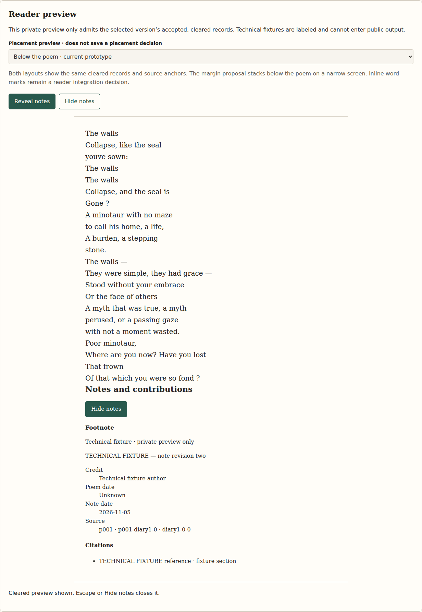
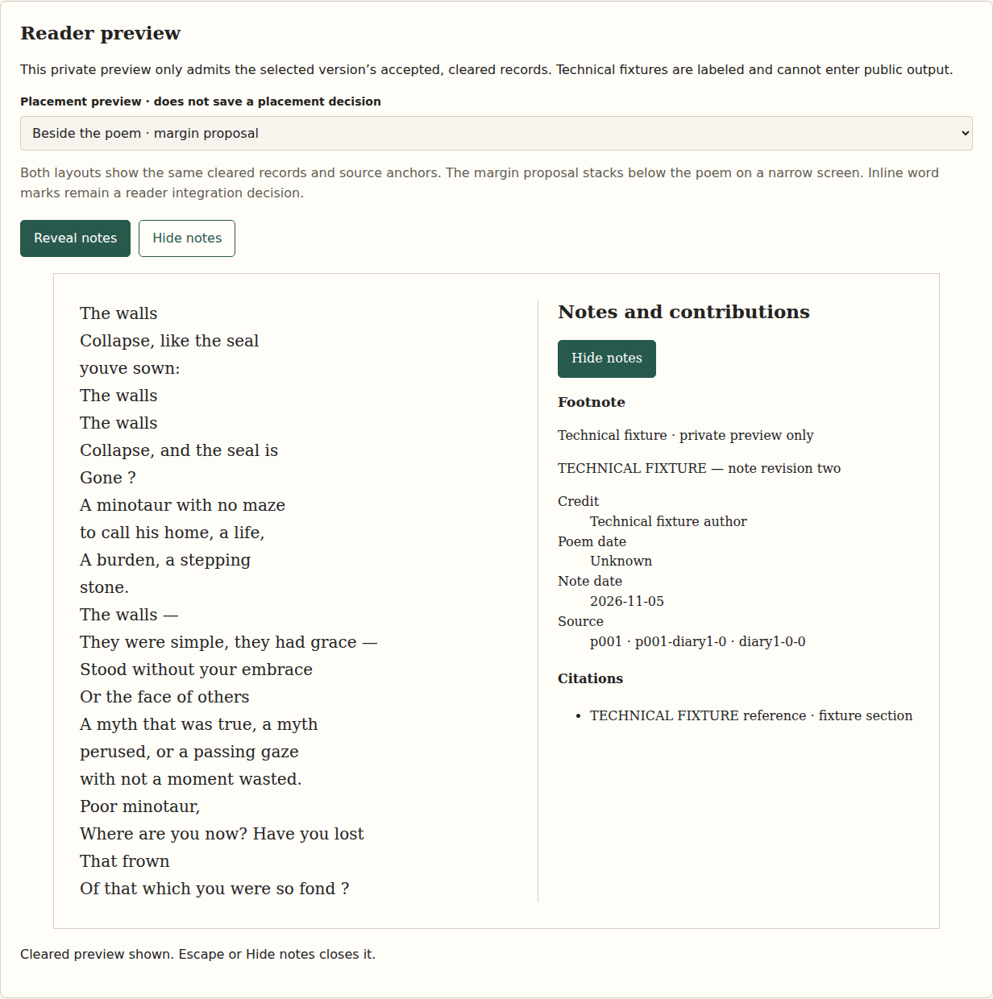
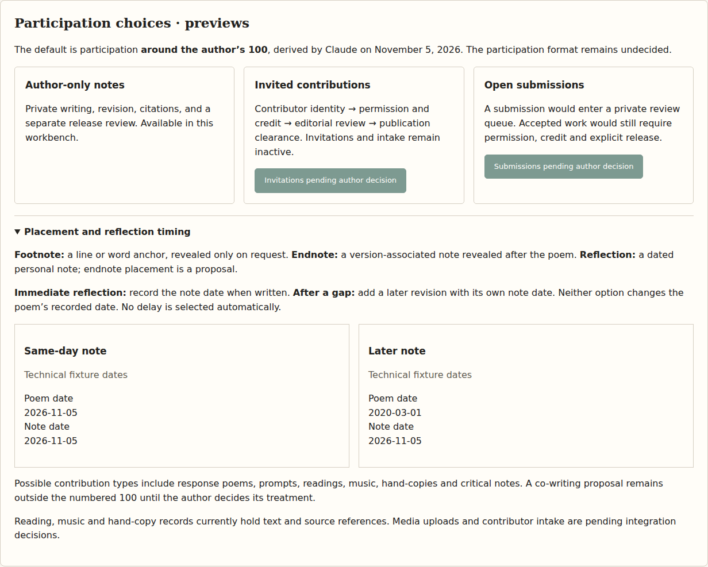

# T05 verification receipt

Local evidence for the private notes and contribution workflow, November 5,
2026 in America/New_York. Machine receipts retain their exact UTC timestamps.
This is implementation evidence using technical fixtures. It is not an author
review, a contributor permission grant or release clearance.

## Source and implementation binding

- Initial main: `d74df372ace00c8a7544ab3b5302cb05418d672c`.
- Refreshed main: `fab6a82b72f23efb16278b90cdc4f7790ca55713`, tree
  `7f90d151f089596c9bd4da4f13652927fe154f7d`.
- Final PR base additionally incorporates documentation-only main
  `038d01fb1862f2e569d231b5b3c4c3a4eb1aecda`; its upstream session-log change
  alters none of the tested code or protected sources. Deferred posting
  findings in #123 are not resolved by these tests.
- Reconciled implementation checkpoint:
  `994c6903b0b5d02dd0be361e969b2b3a916eff35` (full changed-file hashes in
  [tested-files.sha256.json](tested-files.sha256.json)). Documentation and this
  receipt were added after the executable checks; the PR records the final
  complete tree/head.
- [acceptance.json](acceptance.json) records the original author-data/shared-page
  hashes and the browser's 14 acceptance results. `site/data/j.json`,
  `studio/data/review.json`, `site/index.html`, `studio/index.html` and
  `release/public.json` remain byte-identical to the refreshed base.
- The generated source map resolves 126 existing pieces and 156 versions with
  no membership issues. Its `--check` matched both source-file hashes.

## Results

| Check | Observed result | Evidence |
|---|---|---|
| Root Node suites, including model/store/reader/backup | 79 passed, 0 failed | [log](root-node.log), [command/time](root-node.json) |
| Root Python suites, including newly merged posting tests | 156 passed, 1 skipped, 0 failed | [log](root-python.log), [command/time/environment](root-python.json) |
| Cloudflare auth/adapter/revision/proxy unit suites | 52 passed, 0 failed | [log](cf-node.log), [command/time](cf-node.json) |
| Cloudflare Python import/export/SQL suites | 58 passed, 1 skipped, 0 failed | [log](cf-python.log), [command/time](cf-python.json) |
| Real browser/API/D1 workflow | 14 passed | [acceptance receipt](acceptance.json) |
| Repository integrity | 509 references, 0 missing; 518 checksum entries; OK | `python3 tools/check.py` |
| Source-map freshness | Both inputs matched | `python3 tools/notes_sources.py --check` |
| Shared-page handoff | Patch applies cleanly; shared file unchanged | `git apply --check docs/integration/t05-studio-entry.patch` |
| Whitespace | No errors | `git diff --check` |

The skipped Cloudflare Python test requires an external PR #73 export snapshot
that is not present in this environment; generated eight-collection and Unicode
round trips passed. A full Draft 2020-12 schema validator was unavailable; the
schema parses as JSON and runtime model validation is tested. No claim of a
formal schema-validator run is made.

The root Python skip is the test for a system without `fontTools`; this runtime
has it. The full font-enabled run used primary Python plus the pre-existing
T03 `runtime-python` directory for Brotli, with no dependency installation or
repository change. An initial attempt pointed at primary Python without
Brotli: 62 failures/29 skips arose because the upstream test's font probe made
invalid placeholder font bytes while a partial font tool remained available.
That environment mismatch was diagnosed and the complete suite rerun with
both dependencies, producing the final result above. Expected-refusal tests
print some `FAIL`/`REFUSED` tool messages; the unittest summary is the outcome.

## Browser acceptance

The real Cloudflare adapter, Pages Functions middleware/API and local D1
simulation ran in disposable directories, with temporary loopback test JWTs.
The browser was Chromium `153.0.8010.0`, Node `v24.22.1`. Two independent D1
instances tested restoration into empty storage. Browser requests were limited
to the local origin; no browser exceptions or off-origin requests occurred.
No production data, remote database or deployment was used.

The harness verified:

1. Unauthenticated access to the private notes page, module, source map and
   API returned bodyless 403 responses.
2. An existing source with no notes opened with an empty, hidden notes host.
3. A technical note was saved against `p001` / `p001-diary1-0` /
   `diary1-0-0`, retaining distinct author/editor identity and a citation without
   a URL.
4. A second text/date revision preserved the first. Unsaved edits disabled
   editorial actions and record switching until saved or discarded.
5. Editorial acceptance and clearance created separate history entries.
   The four-revision record stayed hidden until requested. Escape cleared the
   DOM and returned focus to the requesting control.
6. The same cleared record rendered below or beside the poem without a storage
   change. Date-only timing fixtures and disabled participation controls were
   present; no invitations/submissions were activated.
7. A malformed UTF-8 backup was rejected before any database write.
8. The browser exported all four note revisions and restored them into the
   second empty database. Read-back was deeply equal to the exported records;
   dates, identities, source anchor, text and history survived page reload.
9. A contribution fixture was separately authored, permission-marked, reviewed
   and credited. Private identity and permission evidence were absent from the
   preview. The author source files and poem/version/release/numbering
   collections were unchanged.
10. Public-mode projection omitted the cleared technical fixtures and their
    private diagnostic IDs. The recorded public result is
    [public-projection.json](public-projection.json).
11. The dark preview fit a 390-pixel viewport in Chromium emulation.
12. A corrected source line invalidated the saved anchor. The preview emptied;
    the original stored anchor was preserved rather than moved.

The 12 narrative steps above group the 14 individual assertions in the machine
receipt. They do not imply physical-phone or production Access verification.

## Reviewable previews

These are captured from the implementation, not illustrative renders. Poem
text comes from the existing source. Every added note/contribution body is an
explicit technical fixture.

### Below-poem note



### Margin proposal



### Participation and reflection timing



[Phone-emulation preview](reader-cleared-phone-emulation.png) shows the credited
contribution alongside the note. [Invalid-anchor evidence](invalid-anchor.png)
shows the blocked source state. The [fixture backup](notes-fixture-backup.json)
contains private technical test revisions and source snapshots; it is never a
production seed or a public release input.

## Reproduce locally

Use the repository's existing Node/Python/Wrangler toolchain and a local
Chromium executable. Set `WRANGLER_BIN` if it is not on PATH; point `--playwright`
at an existing Playwright module when it is not in the runtime's module path.
The evidence directory must be new or empty.

```bash
node --test tests/*.mjs
node --test studio-cf/tests/auth.unit.test.mjs studio-cf/tests/adapter.unit.test.mjs studio-cf/tests/revisions.unit.test.mjs studio-cf/tests/demo-proxy.test.mjs
python3 -m unittest discover -s studio-cf/tests -p 'test_*.py'
VERSFORMS_FONT_PYTHON=/path/to/python-with-fonttools-and-brotli python3 -m unittest discover -s tests -p 'test_*.py'
node tools/verify_notes.mjs --chrome /path/to/chromium --out /path/to/new-evidence
python3 tools/notes_sources.py --check
python3 tools/check.py
```

## Review findings fixed before the final run

Independent review and acceptance testing caught and resolved unsaved-form
review/switching, stale snapshots dropping locally acknowledged revisions,
optional citation-URL handling, fixture provenance removal, private exclusion
diagnostic leakage, and backup input/link/UTF-8/size edge cases. Immutable D1
insertion resolves same-ID races; retry does not change the original revision.
The backup tests include the reproduced malformed-UTF-8 and oversized-envelope
failures and pass with their fixes.

An earlier browser run failed an assertion using `participation.choice`; the
implemented contract is `participation.placement`. The harness was corrected;
the final run above is the complete successful workflow. This was a test-field
mismatch, not a source migration or silent data repair.

## Limits and residuals

T02 has not accepted the proposed fingerprint/word-selector extension. T01/T04
shared-page wiring and T03's real release-event/manifest adapter remain pending.
Native Claude artifact packaging/backend immutability, physical devices,
deployed Access configuration, media contribution handling and fork-resolution
UI were not verified or delivered. Current rendering offers source-ID labels
and placement previews, not final inline footnote marks. The complete owner map
is in the [handoff](../../integration/t05-handoff.md).
